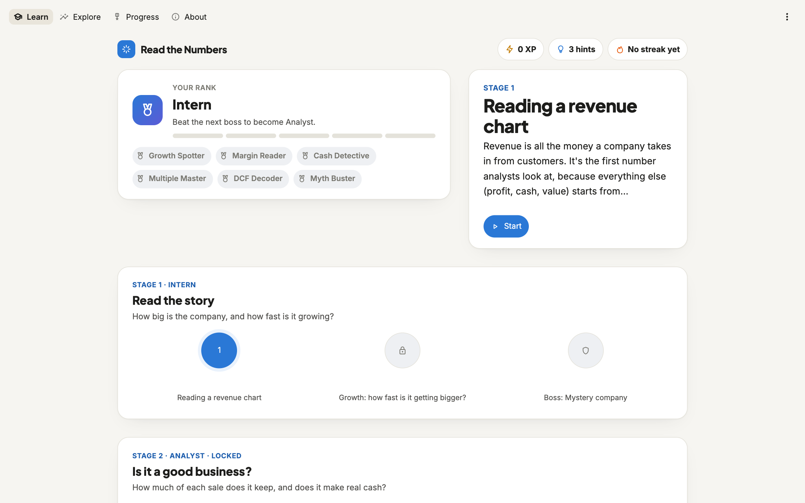
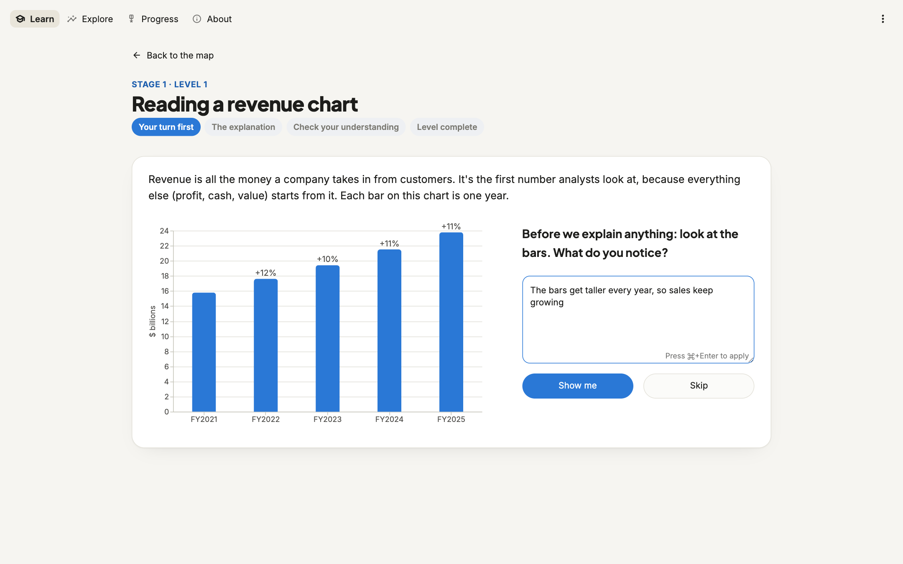
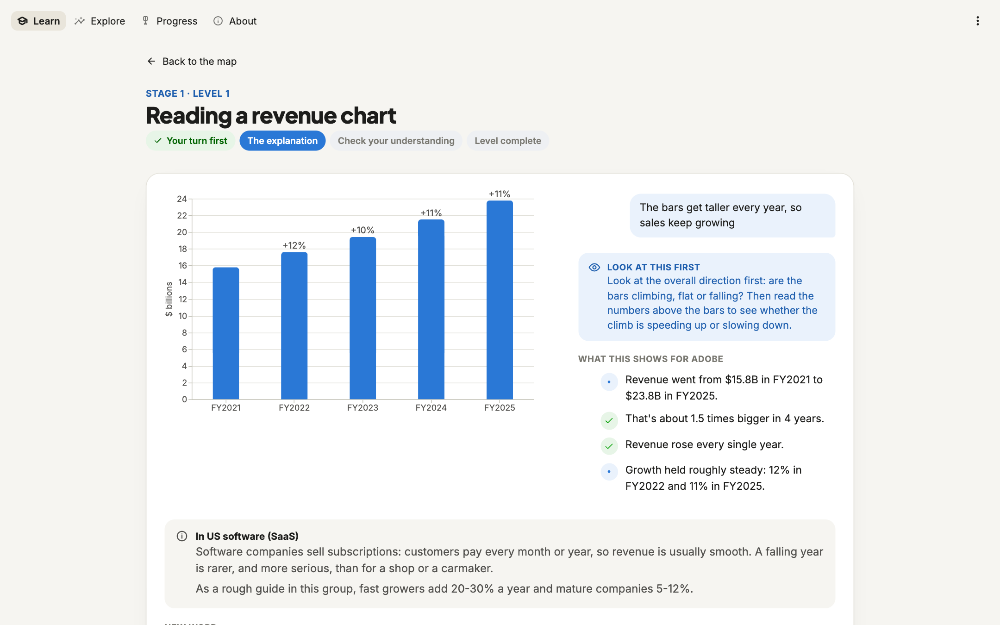
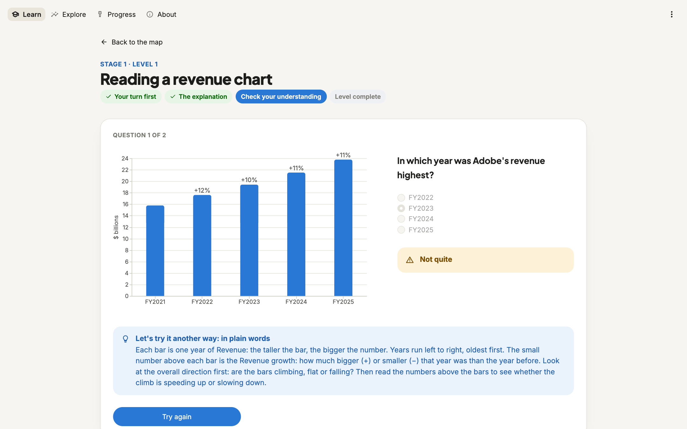
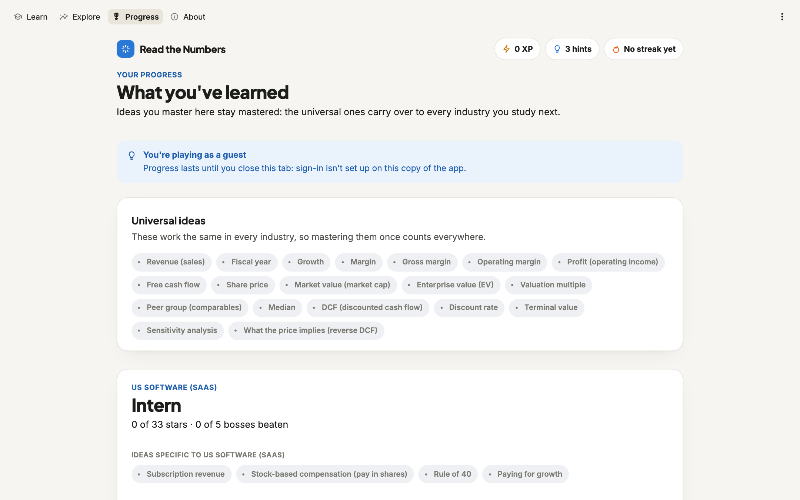
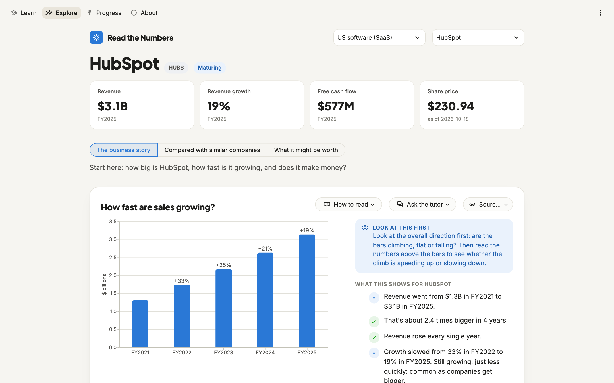

# Read the Numbers

**Learn to read the charts behind a company's valuation, with an AI tutor that adapts to you.**

Read the Numbers is for people who have never read an annual report and don't know what EBITDA, free cash flow or a multiple is. It teaches one idea at a time, always on a real company's real numbers, until you can look at a company and answer the questions an analyst would ask:

- Is it growing, and is growth speeding up or slowing down?
- How much of each sale does it keep, and does that turn into cash?
- Is it expensive next to similar companies, and does its growth explain that?
- What is it worth according to a valuation model, and how much does that depend on the guesses inside it?
- What is today's share price betting on?

It never tells you what to buy or sell. It teaches you to read the numbers.



## How it teaches

**You look first, then it explains.** Every level starts with a chart and one question: *what do you notice?* You write it in your own words, then the explanation builds on what you saw.



**Three layers under every chart:**
- how to read this kind of chart: the axes, what to look at first, what's a good or a worrying sign;
- what's normal in this industry;
- what *this* company's chart shows, written from its actual numbers.



**Mistakes unlock help, not penalties.** Get a question wrong and the same idea comes back explained differently, in this order:
1. how to read the chart;
2. an everyday comparison;
3. the same chart for another company;
4. the simpler idea it builds on.

There are no lives to lose, and hints remove a wrong answer.



**It's a game, from Intern to Managing Director.**
- **Stages:** five, each ending in a boss: a *mystery company* whose name is hidden until you've read its charts.
- **Stars:** for finishing a level, answering right first time, and putting what you see into your own words.
- **XP and ranks:** XP only comes from understanding, never from clicking fast. Ranks rise with every boss.
- **Badges:** earned for real skills, such as *Cash Detective* (telling profit from cash).
- **No leaderboards:** comparing yourself with others discourages beginners.

**An AI tutor that adapts to you (optional).** Claude reads what you noticed and builds on it, re-explains in the style the app chooses for you, answers your questions about the chart on screen, and grades your final pitch. It is held to strict rules:
- **It only uses the numbers on screen.** Each number in a reply is tagged with its source, and a checker compares every one against the data before you see it.
- **It never gives buy or sell advice.** That's blocked by its instructions and by a check on every reply.
- **It can't break a lesson.** If it can't help, you get the written explanation instead.

**Progress you can see.** The Progress page shows what you've mastered. Universal ideas (revenue, margins, multiples, DCF…) stay mastered when you move to another industry.



You can also **explore any company** freely: every chart with its explanations, an "Ask the tutor" button and the source of every number.



## What's inside

The first industry is **US software (SaaS)**: 18 companies, valued by the [SaaS Valuation Engine](https://github.com/ranabrahami/saas-valuation-engine) from their SEC filings. The app is built so the next industry is a module, not a rewrite; the planned second one is **Israeli retail** (Shufersal, Rami Levy, Fox), which works almost entirely differently: IFRS accounts, store leases on the balance sheet, same-store sales, thin margins.

```
src/valuation_tutor/
  core/                  knows nothing about any industry
    sector.py              the SectorModule contract and the Fact type (every number + its source)
    charts/                8 chart kinds, each with a picture, a reading guide and observations
    explain.py             puts the three explanation layers together
    concepts.py            universal concepts, shared by every industry
    path.py, game.py       the learning path, stages, bosses, stars, XP, ranks, badges
    learner.py             the learner model: mastery, struggles, explanation styles tried
    quiz.py                questions whose answers are computed from the data
    tutor/                 the AI tutor: context, prompts, grounding check, caching, caps
    storage.py             progress, tutor cache and usage (SQLite locally, Postgres deployed)
    locales/en.yaml        every word a learner reads
  sectors/saas/
    adapter.py             the only file that imports the valuation engine
    module.py              which metrics, charts, concepts and lessons software adds
    locales/en.yaml        software-specific text
    snapshot/              a dated copy of the engine's inputs, for the deployed app
app/                     Streamlit pages (Learn, Explore, Progress, About) and the design system
tests/                   87 tests, including a fake second industry
```

**Design decisions**
- **Code decides, the AI words.** Pacing, mastery (two right answers in a row on different questions), which explanation style comes next and what can be skipped are plain, tested rules. The tutor writes the words.
- **Questions are computed from the data.** "In which year was revenue highest?" is answered from the actual bars, so questions never go stale and work for any company. That's what makes mystery-company bosses possible.
- **Every number is a Fact with a source.** Charts, explanations and the tutor all read the same Facts, which is what makes the tutor's grounding checkable.
- **Industry-agnostic, proven by a test.** A fake supermarket sector (shekels, IFRS, same-store sales) runs through the entire core. Other tests fail if the core ever imports an industry module, or if words like "SaaS" or "GAAP" appear in core text.

## Adding an industry

A new industry is a folder under `sectors/` and one line in `config/tutor.yaml`; no core code changes. It provides:
- its companies and data, through an adapter around its own engine;
- the metrics and charts that matter in that industry;
- its own concepts and lessons, plus where they slot into the path;
- teaching examples and accounting notes for the tutor.

[docs/ADDING_A_SECTOR.md](docs/ADDING_A_SECTOR.md) has the full contract and a checklist. `tests/fake_sector.py` is a complete minimal example.

## Running it

Requires Python 3.12. The valuation engine sits next to this repo:

```bash
git clone https://github.com/ranabrahami/saas-valuation-engine.git
git clone https://github.com/ranabrahami/valuation-tutor.git
cd valuation-tutor
python3.12 -m venv .venv && source .venv/bin/activate
pip install -e ../saas-valuation-engine -e ".[dev,ai]"
streamlit run app/main.py --server.address localhost
```

- **Data:** it runs on the bundled data snapshot. To use fresh data, run the engine's pipeline and then `python scripts/export_snapshot.py`.
- **The AI tutor:** optional. Add `ANTHROPIC_API_KEY` to a `.env` file. `python scripts/tutor_cost.py` prices it before anything is billed: about $0.12 for one learner's whole path, with per-learner daily caps and a global daily budget in `config/tutor.yaml`.
- **Tests:** `pytest` runs every test against a fake Claude client, so nothing is billed.
- **Deploying:** sign-in and Streamlit Cloud are covered step by step in [docs/DEPLOY.md](docs/DEPLOY.md).

## Disclaimer

For learning only. Nothing here is a recommendation to buy or sell anything. Data comes from public SEC filings and Yahoo Finance, as of the date shown in the app.
